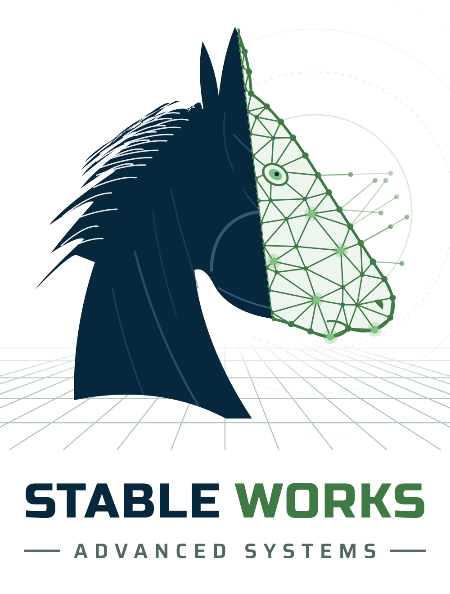

  <picture>
    <source media="(prefers-color-scheme: dark)" srcset="stable-works-emblem.png">
    
  </picture>

<h3 align="center">Advanced systems and digital twins</h3>

<a href="https://stablewerx.com">stablewerx.com</a>

---

Stable Works takes on research-grade problems and carries them all the way to the field. We model each system as a live digital twin first, then build the hardware and software against it, and we stay with it until it holds up where it is actually used.

**What we build:** digital twins, autonomy and human-machine teaming, situational awareness, resilient networks, post-quantum security, and embedded edge systems.

**Where:** defense and security, agriculture, logistics, manufacturing, energy and infrastructure, and aerospace.

## The Horsepower family

One core, three fields. A fix in one reaches all of them.

| | |
|---|---|
| **War Horse** | Battlespace awareness. Every Cursor on Target event is signed on the device with ML-DSA-65, mission chat is sealed with ML-KEM-768, and ATAK, WinTAK, and iTAK join on day one. |
| **PlowHorse** | Field awareness. A live map of every person and machine on the farm, with crew chat, push to talk, field zones, and maps that keep working without signal. |
| **Workhorse** | Warehouses and logistics yards, next. |

## How we work

Research from first principles, model the twin, prototype in front of the people who will use it, and field it hardened, signed, and supportable.

---

&copy; Stable Works LLC

